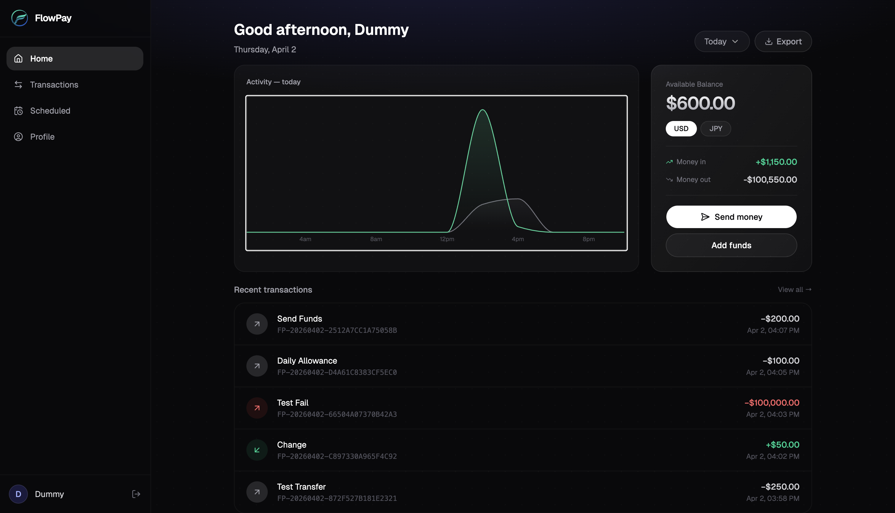
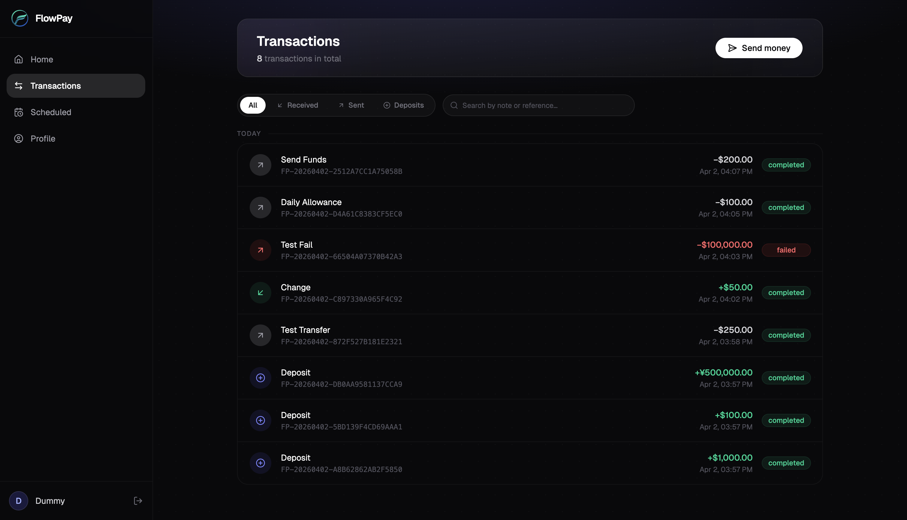
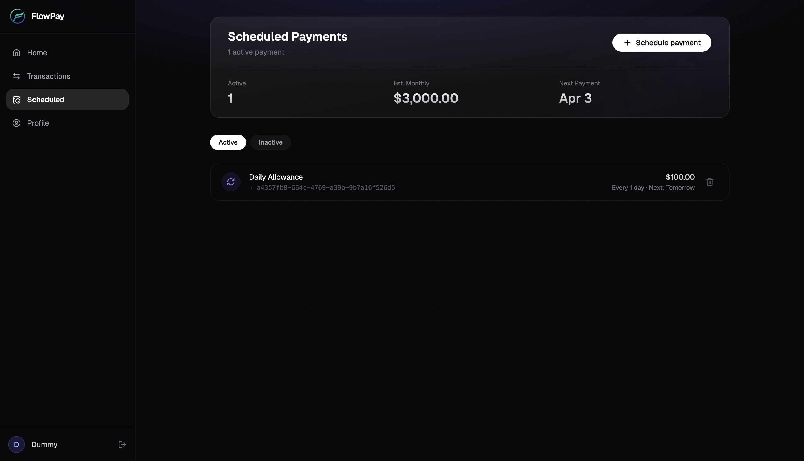
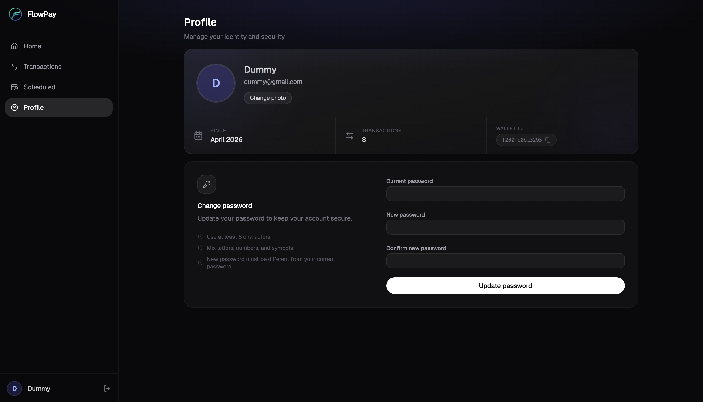
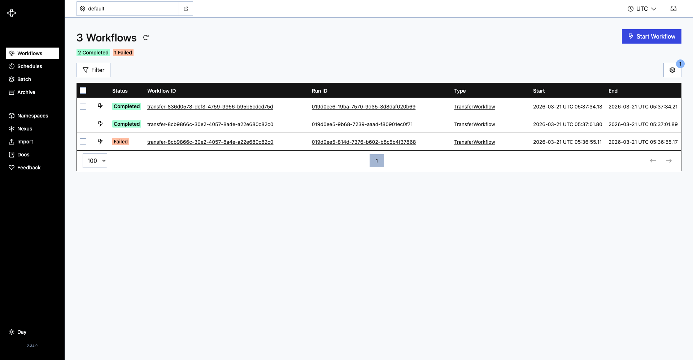
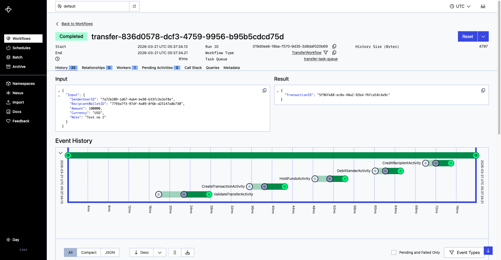

# FlowPay

## Overview

FlowPay is a comprehensive digital wallet and payment processing system engineered for high reliability and consistency. Developed with a Go backend and a React/TypeScript frontend, it leverages Temporal orchestration to manage multi-step financial transactions securely. FlowPay features a complete client-server architecture with stateful transaction management, ensuring that payment operations are resilient to failures, utilizing a Saga pattern for robust compensating actions and reversals.

## Features

### Payment & Wallet Engine
- **Multi-Currency Wallets** - Automatic wallet creation upon user registration supporting multiple currency balances.
- **Idempotent Transactions** - Secure money transfers through discrete, idempotent steps (Validate, Create, Hold, Debit, Credit).
- **Saga Pattern Reversals** - Fully implemented `ReverseTransfer` acting as a compensating transaction that safely rolls back funds, debits recipients, and releases holds on failure.
- **Real-time Synchronization** - Server-Sent Events (SSE) streaming updates to the dashboard for live transaction and wallet balance states.
- **Scheduled Payments** - Schedule one-off or recurring payments with full lifecycle management (create, pause, reactivate, cancel), backed by a dedicated Temporal workflow with cron-style scheduling.

### Workflow Orchestration (Temporal)
- **Deterministic Workflows** - Multi-step payment workflows orchestrated deterministically, independent of direct DB calls within the workflow definition.
- **Resilient Activities** - Business logic encapsulated in retryable Temporal activities with exponential backoffs and timeouts.
- **Graceful Failure Handling** - Automatic triggering of compensating operations (Saga) mid-workflow upon component failure.

### Robust Backend Features
- **Authentication** - Secure user registration and login flows using JWT (`golang-jwt/jwt/v5`).
- **Structured Logging & Tracing** - Built using Go's `log/slog` with JSON handlers, coupled with `X-Request-ID` middleware for transaction correlation.
- **Graceful Shutdown** - SIGINT/SIGTERM handling for draining in-flight HTTP requests and Temporal workers safely.
- **API Documentation** - Fully documented REST API served via Swagger.

### Modern Dashboard UI
- **Interactive Interface** - Built with React 19, Tailwind CSS 4, and `shadcn/ui` for a responsive, modern aesthetic.
- **Live Transaction Monitoring** - Real-time displays for transaction histories, pending transfers, and live balance updates.
- **Dynamic Modals** - Intuitive popups for sending money and depositing funds.
- **Profile Management** - Avatar upload/delete (S3-backed, MinIO locally), display name, email, and password editing with a glassmorphism profile card.
- **Full Page Suite** — Home (balance overview, activity chart, recent transactions), Transactions (date-grouped history, full-text search, detail modal), Scheduled Payments (status filters, stats cards, lifecycle controls), and Profile pages.

---

## Code layout

```text
FlowPay/
├── flowpay-be/             # Go REST API and Temporal worker
├── flowpay-fe/             # React frontend (Vite)
├── temporal/               # Temporal setup scripts and dynamic config
├── terraform/              # AWS infrastructure, foundation and app layers
├── docs/                   # Screenshots
├── .github/workflows/      # Image build, frontend upload, deploy
├── docker-compose.yml      # Whole stack in containers, behind Nginx
└── docker-compose.dev.yml  # Local development stack
```

### Backend (`flowpay-be/`)
A Go server built on Gin and GORM:

| Package | Description |
|---------|-------------|
| `api/handler/` | REST endpoint handlers bound to domain services. |
| `service/` | Business logic for wallets, auth and transfers. |
| `temporal/` | Workflow definitions, activity wrappers and worker setup. |
| `repository/` | PostgreSQL access through GORM. |
| `config/` | Application configuration. |
| `models/` | Domain entities. |
| `storage/` | S3 client for user avatars. |

### Frontend (`flowpay-fe/`)
A React single-page app built with Vite:
- **Data fetching**: an Axios client with a service module per feature.
- **Live data**: `@microsoft/fetch-event-source` listening to the backend's SSE stream.
- **UI components**: `shadcn/ui`, `lucide-react` and React Hook Form.

---

## Technology Stack

| Category | Technologies |
|----------|--------------|
| **Backend** | Go 1.25, Gin, GORM, Temporal Go SDK |
| **Frontend** | React 19, TypeScript, Vite, TailwindCSS 4, shadcn/ui |
| **Database** | PostgreSQL 17 |
| **Orchestration**| Temporal Server v1.30.1 |
| **Infrastructure**| Docker, Docker Compose, Nginx |
| **Storage** | Amazon S3 for user avatars, MinIO locally |
| **Security** | JWT, bcrypt |

---

## Installation

### Prerequisites
- **Docker & Docker Compose**
- **Go 1.25 or higher**
- **Node.js 20 or higher**

### Local Setup

1. **Clone the repository:**
```bash
git clone https://github.com/yourusername/FlowPay.git
cd FlowPay
```

2. **Start the Infrastructure (Temporal, Postgres, etc.):**
```bash
docker compose -f docker-compose.dev.yml up -d
```

3. **Run the Backend:**
Open a terminal and execute the Go backend application.
```bash
cd flowpay-be
go run main.go
```

4. **Run the Frontend:**
Open a new terminal session.
```bash
cd flowpay-fe
npm install
npm run dev
```

### Configuration
You may configure environment settings by duplicating the template:
```bash
cp .env.example .env
```
Ensure configurations match your active PostgreSQL setup and Temporal connection parameters.

---

## Screenshots













---

## Usage

1. **Access the Web Dashboard** at `http://localhost:5173`.
2. **Register a new account** (which automatically provisions a multi-currency wallet).
3. **Deposit funds** into the wallet using the Dashboard modal.
4. **Initiate a Transfer** to another registered user using discrete money movements.
5. **Monitor Orchestration**: Open the Temporal Web UI at `http://localhost:8233` to view the real-time execution of the background Saga workflow, tracking retry attempts, activity timelines, and fault-toleration states.
6. **Schedule a Payment**: Navigate to the Scheduled Payments page to create a future or recurring payment, then pause, reactivate, or cancel it from the same dashboard.
7. **Manage your Profile**: Visit the Profile page to upload an avatar, update your display name or email, and change your password.
