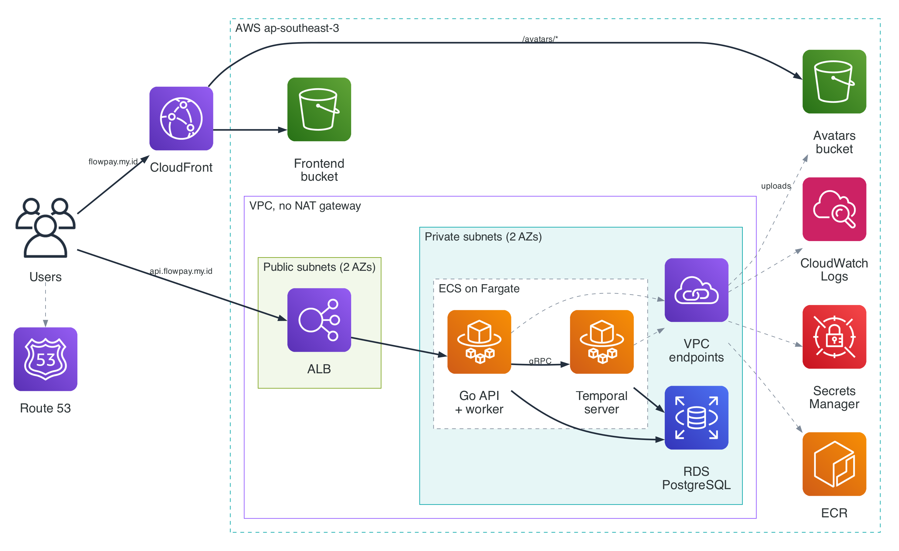
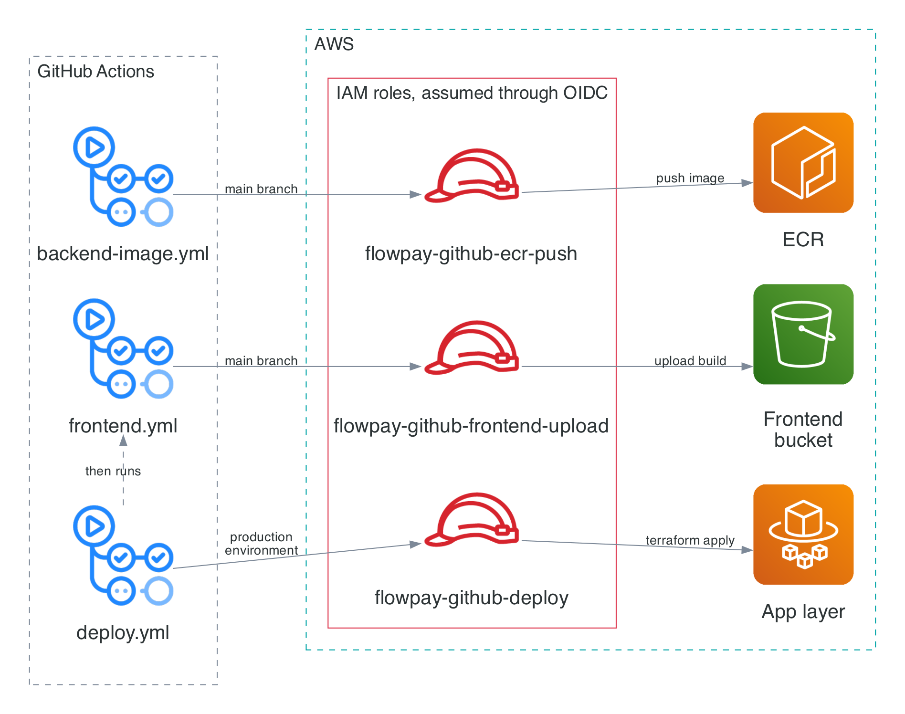

# FlowPay

## Overview

FlowPay is a comprehensive digital wallet and payment processing system engineered for high reliability and consistency. Developed with a Go backend and a React/TypeScript frontend, it leverages Temporal orchestration to manage multi-step financial transactions securely. FlowPay features a complete client-server architecture with stateful transaction management, ensuring that payment operations are resilient to failures, utilizing a Saga pattern for robust compensating actions and reversals.

---

## Architecture on AWS



The frontend is a React build in a private S3 bucket behind CloudFront at `flowpay.my.id`. The API at `api.flowpay.my.id` is an Application Load Balancer in front of the Go backend on ECS Fargate, and the backend starts every transfer as a workflow on a self-hosted Temporal server, also on Fargate. Both keep their data in RDS PostgreSQL, and inside the VPC everything except the load balancer runs in private subnets.

### Design decisions

- **No NAT gateway.** The private subnets have no internet access. ECS tasks reach ECR, CloudWatch Logs and Secrets Manager through interface VPC endpoints, and S3 through a gateway endpoint.
- **No stored AWS keys in CI.** GitHub Actions gets short-lived credentials through OIDC, and each workflow assumes its own IAM role. The deploy role only trusts jobs in the `production` environment, which only `main` can use.
- **A deploy role that can't escalate.** The role that runs Terraform gets only the actions the app layer needs, scoped to FlowPay's names where AWS allows it. Every IAM role it creates has to carry a permissions boundary that caps it at what the backend and Temporal need.
- **Secrets live in Secrets Manager.** RDS generates the database password and keeps it there, Terraform generates the JWT secret as an ephemeral value so it never lands in the state, and ECS injects both into the containers at start.
- **TLS at the edge and to the database.** The ALB only listens on 443 and only accepts TLS 1.2 and 1.3, and both the backend and Temporal verify the RDS server certificate.
- **Temporal on Fargate.** The backend finds it at `temporal.flowpay.local` through Cloud Map. Schema setup and namespace creation run as containers in the same task, ordered with `dependsOn`.
- **No cache invalidations.** Vite names assets after their content, so they're cached for a year as `immutable`, while `index.html` is sent with `no-cache`. A frontend deploy only uploads files.
- **ARM64 throughout.** Images are built on ARM runners for Fargate on Graviton, tagged with the commit that last changed the backend, and pushed to an ECR repo with immutable tags. Temporal's images come through an ECR pull-through cache of Docker Hub.
- **Two Terraform layers.** [`terraform/foundation/`](terraform/foundation) holds the shared pieces (VPC, DNS, certificates, ECR, CI roles), and [`terraform/app/`](terraform/app) holds everything that runs the app, reading foundation's outputs through remote state.

### CI/CD



- [`backend-image.yml`](.github/workflows/backend-image.yml) builds the ARM64 backend image and pushes it to ECR when backend code changes on `main`.
- [`frontend.yml`](.github/workflows/frontend.yml) builds the frontend and uploads it to S3 with the cache headers above when frontend code changes on `main`.
- [`deploy.yml`](.github/workflows/deploy.yml) runs Terraform for the app layer from the Actions tab, after checking that the backend image is in ECR.

---

## How a transfer runs

A transfer is a Temporal workflow that runs five activities in order: `ValidateTransfer`, `CreateTransaction`, `HoldFunds`, `DebitSender` and `CreditRecipient`. Activities retry with exponential backoff, and business errors like insufficient funds are non-retryable, so they fail the workflow right away. If the debit or the credit fails, the workflow runs `ReverseTransfer` as a compensating step, which releases the hold and returns the sender's money.


---

## Features

### Payments and wallets
- **Multi-currency wallets** - Each user has one wallet, with a balance per currency created the first time money arrives in that currency.
- **Transfers** - Every transfer request carries an `Idempotency-Key`, so a retried request doesn't send money twice.
- **Reversals** - The sender can reverse a completed transfer, which moves the money back as a compensating transaction.
- **Live updates** - The dashboard gets transaction and balance updates over Server-Sent Events, checked every 2 seconds.
- **Recurring payments** - Payments every N days that can be cancelled and reactivated, each run by a long-lived Temporal workflow.

### Backend
- **Authentication** - JWT (`golang-jwt/jwt/v5`) with bcrypt-hashed passwords.
- **Logging** - App logs in JSON through `log/slog`, and an `X-Request-ID` on every response.
- **Graceful shutdown** - On SIGINT or SIGTERM, the backend stops the Temporal worker before the HTTP server.
- **API docs** - Swagger at `/docs` when running locally.
- **Tests** - Unit tests for the services and the workflows, including each failure path, and Vitest tests for the frontend.

### Dashboard
- **Home** - Balance per currency, an activity chart, money in and out, and recent transactions.
- **Transactions** - Date-grouped history with type filters, search by note or reference, and a detail view.
- **Recurring payments** - Status filters, summary cards and controls to cancel and reactivate.
- **Profile** - Avatar upload to S3, display name and password changes.

---

## Code layout

```text
FlowPay/
├── flowpay-be/             # Go REST API and Temporal worker
├── flowpay-fe/             # React frontend (Vite)
├── temporal/               # Temporal setup scripts and dynamic config
├── terraform/              # AWS infrastructure, foundation and app layers
├── docs/                   # Screenshots and architecture diagrams
├── .github/workflows/      # Image build, frontend upload, deploy
├── docker-compose.yml      # Whole stack in containers, behind Nginx
└── docker-compose.dev.yml  # Local development stack
```

### Backend (`flowpay-be/`)
A Go server built on Gin and GORM:

| Package | Description |
|---------|-------------|
| `api/handler/` | REST endpoint handlers bound to domain services. |
| `service/` | Business logic for wallets, auth and transfers. |
| `temporal/` | Workflow definitions, activity wrappers and worker setup. |
| `repository/` | PostgreSQL access through GORM. |
| `config/` | Application configuration. |
| `models/` | Domain entities. |
| `storage/` | S3 client for user avatars. |

### Frontend (`flowpay-fe/`)
A React single-page app built with Vite:
- **Data fetching**: an Axios client with a service module per feature.
- **Live data**: `@microsoft/fetch-event-source` listening to the backend's SSE stream.
- **UI components**: `shadcn/ui`, `lucide-react` and React Hook Form.

---

## Technology stack

| Category | Technologies |
|----------|--------------|
| **Backend** | Go 1.25, Gin, GORM, Temporal Go SDK |
| **Frontend** | React 19, TypeScript, Vite, Tailwind CSS 4, shadcn/ui |
| **Database** | PostgreSQL 17 on Amazon RDS |
| **Orchestration** | Temporal 1.30.1, self-hosted |
| **Cloud** | AWS: ECS on Fargate, RDS, ALB, CloudFront, S3, Route 53, ACM, Cloud Map, Secrets Manager, ECR, CloudWatch |
| **Infrastructure as code** | Terraform |
| **CI/CD** | GitHub Actions with OIDC |
| **Local development** | Docker Compose, Nginx, MinIO |
| **Security** | JWT, bcrypt |

---

## Installation

### Prerequisites
- **Docker & Docker Compose**
- **Go 1.25 or higher**
- **Node.js 20 or higher**

### Local Setup

1. **Clone the repository:**
```bash
git clone https://github.com/yourusername/FlowPay.git
cd FlowPay
```

2. **Start the Infrastructure (Temporal, Postgres, etc.):**
```bash
docker compose -f docker-compose.dev.yml up -d
```

3. **Run the Backend:**
Open a terminal and execute the Go backend application.
```bash
cd flowpay-be
go run main.go
```

4. **Run the Frontend:**
Open a new terminal session.
```bash
cd flowpay-fe
npm install
npm run dev
```

### Configuration
You may configure environment settings by duplicating the template:
```bash
cp .env.example .env
```
Ensure configurations match your active PostgreSQL setup and Temporal connection parameters.

---

## Screenshots


---

## Usage

1. **Access the Web Dashboard** at `http://localhost:5173`.
2. **Register a new account** (which automatically provisions a multi-currency wallet).
3. **Deposit funds** into the wallet using the Dashboard modal.
4. **Initiate a Transfer** to another registered user using discrete money movements.
5. **Monitor Orchestration**: Open the Temporal Web UI at `http://localhost:8233` to view the real-time execution of the background Saga workflow, tracking retry attempts, activity timelines, and fault-toleration states.
6. **Schedule a Payment**: Navigate to the Scheduled Payments page to create a future or recurring payment, then pause, reactivate, or cancel it from the same dashboard.
7. **Manage your Profile**: Visit the Profile page to upload an avatar, update your display name or email, and change your password.
